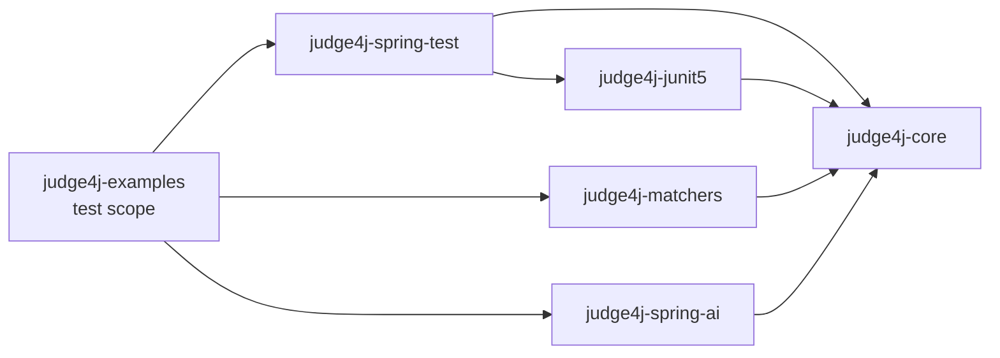
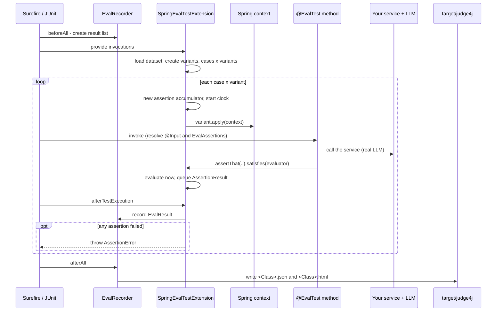

# Judge4j Architecture

## Purpose and scope

Judge4j is a Java 17+ / Maven library for **evaluating LLM prompts and models as JUnit 5 tests**. An
evaluation test boots a Spring test context, applies one *variant* (for example a different system
prompt or model), runs the application's real code path - which calls a real LLM - and scores the
result. It does this for every combination of test case and variant and writes a JSON file plus a
self-contained HTML comparison report.

What it is deliberately *not*: a server, a black-box endpoint tester, a hosted viewer, a provider
matrix, or a replacement for tools such as promptfoo. Its niche is the **developer loop**, where the
output only becomes meaningful after the application's own post-processing and exposing an endpoint
just to test that would be overhead.

## Modules

```
judge4j-parent/                 aggregator pom: versions, release profile, metadata
|-- judge4j-core                result model, Evaluator, dataset loader, JSON store, HTML report
|-- judge4j-junit5              @EvalTest / @EvalTestCases / @Input, EvalRecorder
|-- judge4j-matchers            deterministic Evaluator<String> library
|-- judge4j-spring-test         @EvalVariants, EvalVariant, SpringEvalTestExtension
|-- judge4j-spring-ai           RubricEvaluator (LLM judge), EmbeddingSimilarityEvaluator
`-- judge4j-examples            summarizer Spring Boot app + live evaluations (not published)
```



`judge4j-core` depends only on Jackson (JSON, YAML, java-time); it has no JUnit, Spring or Spring AI
dependency, so the model, evaluators and report are reusable anywhere. `judge4j-spring-test` adds
`spring-test` and Mockito; `judge4j-spring-ai` adds only `spring-ai-client-chat`.

| Module | Key types |
|---|---|
| `judge4j-core` | `Evaluator<T>`, `Evaluation`, `EvalAssertions` / `EvalAssertion<T>`, `TestCase`, `TestCaseLoader`, `AssertionResult`, `EvalResult`, `RunResult`, `RunResultStore`, `ReportGenerator`, `HtmlReportGenerator`, `EvalContext` |
| `judge4j-junit5` | `@EvalTest` (a `@TestTemplate`), `@EvalTestCases`, `@Input`, `EvalRecorder` |
| `judge4j-matchers` | `Matchers` (static factory of `Evaluator<String>`) |
| `judge4j-spring-test` | `@EvalVariants`, `EvalVariant`, `EvalVariantFactory`, `EvalVariantContext`, `SpringEvalTestExtension` |
| `judge4j-spring-ai` | `RubricEvaluator`, `EmbeddingSimilarityEvaluator` |

## Data model

```
RunResult   runId, label, timestamp, results[]                one per test class execution
 `-- EvalResult   testCaseId, testCaseDescription, inputs{}, variantLabel,
                  output, score, pass, latencyMs, error, assertions[]
      `-- AssertionResult   label, expectation, input, weight, pass, score, feedback
```

- An `EvalResult` is one **test case x variant** cell; its `assertions` are the checks made inside the
  test method. `testCaseId` is `Class#method:caseId`.
- `pass` is true only if every assertion passed and nothing threw. `score` is the sum of the weights of
  passing assertions divided by the total weight.
- `weight` is a percentage. Explicit weights total at most 100; the remainder is shared equally by
  assertions without one (or all of 100 is shared equally if none specify).
- `output` is the value passed to the **first** assertion of the run.
- `latencyMs` is the wall time of the test method *excluding* time spent inside evaluators, so judge and
  embedding calls are not counted.
- Everything is immutable. `Evaluation` rejects scores outside `[0, 1]` and `NaN` at construction.
- JSON uses ISO-8601 timestamps and ignores unknown fields on read. Values Jackson cannot serialize
  (cyclic graphs, hostile getters) are written as their `toString()` rather than failing the report.

## Evaluators and assertions

`Evaluator<T>` is a functional interface: `Evaluation evaluate(T actual)`, where
`Evaluation(pass, score, feedback)`. `negate()` inverts pass and score and explains what the original
check found.

An assertion is built fluently and evaluated **immediately** when `satisfies` is called:

```java
evaluations.assertThat(actual).named("..").expecting("..").weight(30).satisfies(evaluator);
```

Evaluators that need two values take a small input record, such as
`RubricEvaluator.Input(request, response)` or `EmbeddingSimilarityEvaluator.Input(actual, expected)`.

- **`Matchers`** - pure functions over `String`. A `null` actual always fails; arguments (including
  regexes and expected JSON) are validated at creation. `isJson` is strict (one value, nothing
  trailing); `containsJson` finds embedded JSON by trying each opening brace or bracket.
- **`RubricEvaluator`** - abstract; a subclass supplies `rubric()`. It renders a fixed judge prompt in
  which the request and response sit inside `<request>` / `<response>` delimiters and are declared to be
  data, calls a Spring AI `ChatClient` and binds a structured `{pass, explanation}` verdict. Score is 1.0
  or 0.0. The judge is whichever `ChatClient.Builder` you supply (constructor, or autowired when the
  evaluator is a bean); supplying a different model avoids a model grading itself.
- **`EmbeddingSimilarityEvaluator`** - embeds both texts in one call and passes when cosine similarity is
  at least the threshold. Score is the similarity clamped to `[0, 1]`; blank text and zero-magnitude
  embeddings fail with an explanation; mismatched dimensions are an error.

## Execution flow

`@EvalVariants` is a composed annotation. It registers `SpringExtension`, `EvalRecorder` and
`SpringEvalTestExtension`; tags the class `eval`; runs it on a single thread; and takes an exclusive JUnit
resource lock so evaluation classes can never run concurrently (variants mutate shared Spring state).
`@EvalTest` is a `@TestTemplate`, so its method only runs when an invocation provider supplies
invocations.



Details:

- **Fan-out.** One invocation per (case, variant), cases outer and variants inner; display name
  `[caseId, variantLabel]`. Variants are created once per class. The dataset must be non-empty with
  unique ids; variant labels must be unique and there must be at least one - otherwise the class fails
  with a message naming the problem.
- **Variants.** An `EvalVariant` is an immutable label plus ordered setup steps
  (`Consumer<EvalVariantContext>`); `bean(Class)` is a typed lookup. The framework does no Mockito itself.
  The context is shared, so a variant must set up everything it differs on.
- **Inputs.** `@Input("k")` resolves `vars["k"]`; values convert through Spring's `DefaultConversionService`
  (the YAML number `5` becomes `int`, `long` or `String`; lists convert element-wise). A missing variable,
  an impossible conversion or a `null` for a primitive fails the run with a message naming the case and
  variable.
- **Weights** are checked in `satisfies` *before* the evaluator runs, so an over-budget assertion costs no
  judge call.
- **Failure semantics.** Assertions never throw individually, so all of them run. After the method:
  an exception (including a failing variant setup or a throwing evaluator) records an error result with
  the assertions collected so far and lets the exception propagate; no assertions records an error result
  and throws; otherwise the weighted result is recorded and, if it did not pass, an `AssertionError` listing
  the failing assertions is thrown. A result is recorded in every case.
- **Reporting.** `EvalRecorder` keeps results in a synchronized list per test class. In `afterAll` it wraps
  them in a `RunResult` and writes `<ClassName>.json` and `<ClassName>.html`, claiming a unique file name per
  JVM (`Name-2` on collision) and falling back to the binary name for anonymous classes. A report is written
  even if there are no results; the page then says so. `EvalRecorder` is also a parameter resolver for
  `EvalContext`, a low-level `record(...)` API for plain JUnit tests that do not use variants.

## Reporting

`HtmlReportGenerator` writes one HTML file: a static template plus the `RunResult` serialized into a
`<script type="application/json">` block (with `<` escaped so no value can close the element), rendered
client-side with no external requests and no dependencies. Sections: run metadata; per-variant pass rate,
average score and average latency; a per-assertion score chart; a case-by-variant heatmap; a summary table;
and a side-by-side grid with one row per test case (showing its inputs) and one column per variant, each
cell showing the output, a score chip per assertion and a failure banner; clicking a cell opens every
assertion's weight, score, expectation, feedback and input. It follows the viewer's light or dark theme.
All dynamic text is HTML-escaped when rendered.
`generateDiff(baseline, candidate, path)` renders two runs in one page, each variant a column prefixed with
its run label; it shows both, it does not compute a difference.

The report is exercised against awkward data in `ReportGalleryTest` (empty run, one variant, ten variants,
hand-recorded results, errors, hostile strings, structured and cyclic outputs, very long text, a
comparison). It writes `target/report-gallery/`, which is worth opening in a browser after changing the
template.

## The example module

`judge4j-examples` is a runnable document-summarization service (Spring Boot 3.5, Spring AI 1.1):
`POST /api/v1/summaries` -> `SummarizationService`, which validates the document, builds a system and user
prompt from `prompts/*.st`, calls a `ChatClient` with structured output and enriches the result. Provider
and model come from `application.yml` (`spring.ai.model.chat`: `anthropic`, `openai` or `google-genai`).

Two evaluations exercise it **without HTTP**, by wrapping the service in a Mockito spy
(`SummarizerTestSupport.SpyConfiguration`) and stubbing one seam method per variant:

| Evaluation | Compares | Seam | Shows |
|---|---|---|---|
| `SummarizerPromptEvalTest` | the standard vs a concise system prompt | `buildSystemMessage()` | matchers, a custom evaluator, an LLM judge, embedding similarity (positive and negated), deliberate `[demo failure]`s |
| `SummarizerModelEvalTest` | three models, same prompt | `chatClient()` | per-model quality and latency; a self-check that each response came from the requested model |

Both evaluation classes share one cached Spring context, so every variant starts with `Mockito.reset(spy)`.
The rubric judge uses a model different from those under test (`judge4j.example.judge-model`).

Because they make real, billable calls, the evaluations are excluded from the default build: the module's
Surefire configuration excludes the `eval` tag and the `evals` profile includes only that tag and sets
`testFailureIgnore` so the demo failures do not break the build.

| Command | Effect |
|---|---|
| `./mvnw test` | all unit tests; the examples module runs no evaluation; no key needed |
| `./mvnw test -Pevals -pl judge4j-examples -am` | live evaluations; failures reported, build not failed |
| add `-Djudge4j.ignoreEvalFailures=false` | live evaluations that fail the build on any failed assertion |

## Quality gates

- `./mvnw verify` - unit and engine tests for every module; no network or credentials. The engine
  (`SpringEvalTestExtensionTest`) runs about two dozen scenarios through the JUnit Launcher.
- `./mvnw -Prelease -Dgpg.skip=true -DskipTests package` - builds sources and Javadoc jars; Javadoc lint
  (`doclint all,-missing`) must pass.
- `scripts/check-release-ready.sh` - fails on key-shaped literals and missing legal files.
- `.github/workflows/ci.yml` - runs the above on Java 17 and 21.
- `.github/workflows/release.yml` - on a `v*` tag: sets the version from the tag, tests, builds the jars, creates a
  GitHub Release with them attached and, when the Central secrets exist, publishes to Maven Central.

## Extension points

| Need | How |
|---|---|
| New check | Implement `Evaluator<T>`; use it with `satisfies(...)`. |
| New LLM-judged criterion | Subclass `RubricEvaluator`, return the criterion from `rubric()`. |
| Different thing to compare | Return other `EvalVariant`s from an `EvalVariantFactory` (prompt, model options, config, mocked collaborators). |
| New cases | Add YAML entries; reference the file with `@EvalTestCases`. |
| Different output location or run label | `judge4j.output-directory`, `judge4j.label`. |
| Different report | Implement `ReportGenerator`. |

## Scope of this version

- Variants and the case fan-out require Spring; plain JUnit gets only the hand-recording `EvalContext`.
- Evaluation classes run strictly one at a time.
- Only the final output is stored - not the rendered prompt, the raw model response or per-call model
  metadata - and cost is not tracked.
- No response caching, record/replay, throttling or retry beyond what the provider client does.
- No baseline pass/fail comparison or suite-level pass-rate gate: any failed assertion fails its test
  (the profile can be told to ignore that).
- Datasets are YAML on the classpath.

Planned additions are tracked in [TODO.md](TODO.md).
