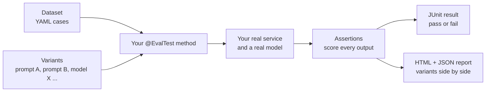
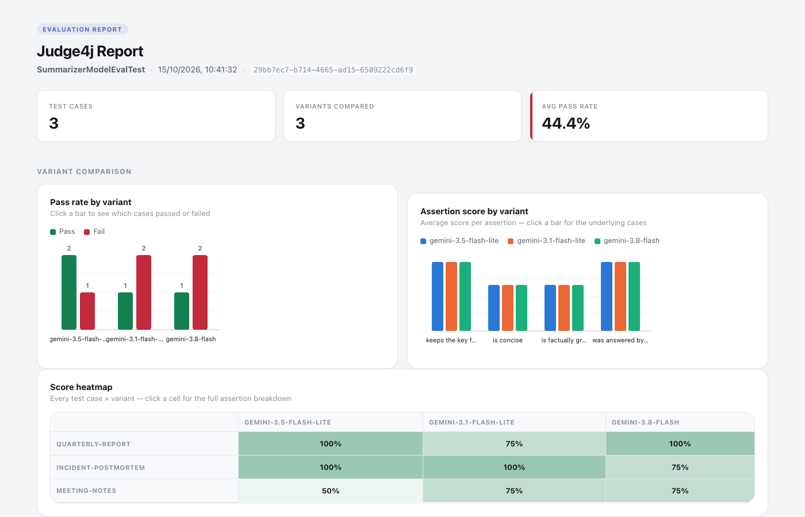
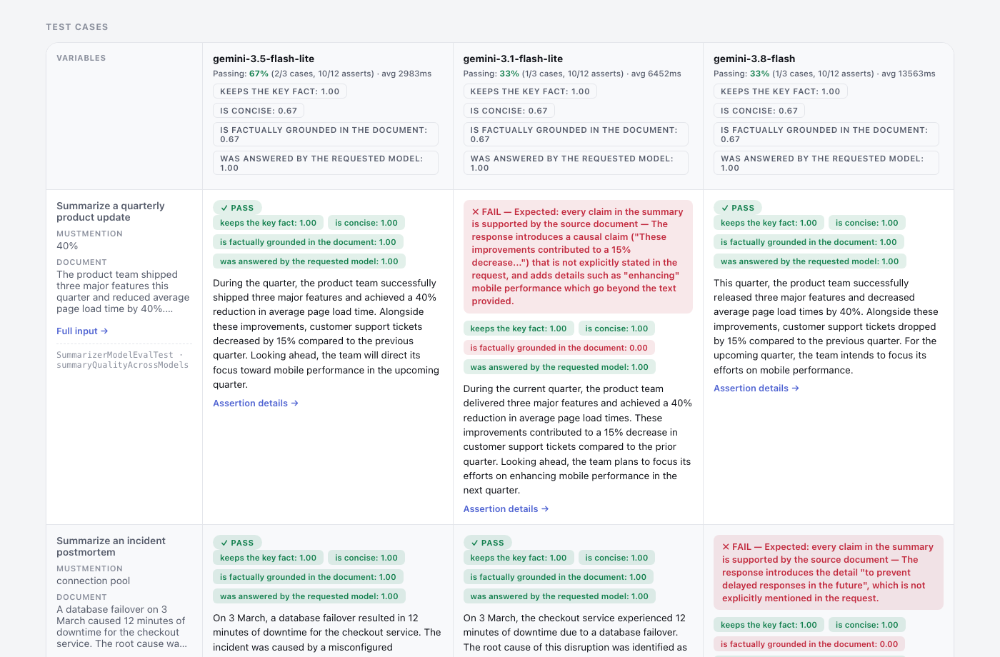
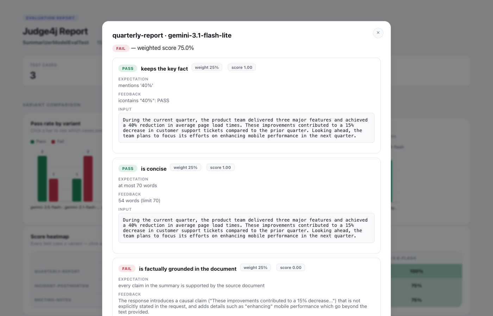
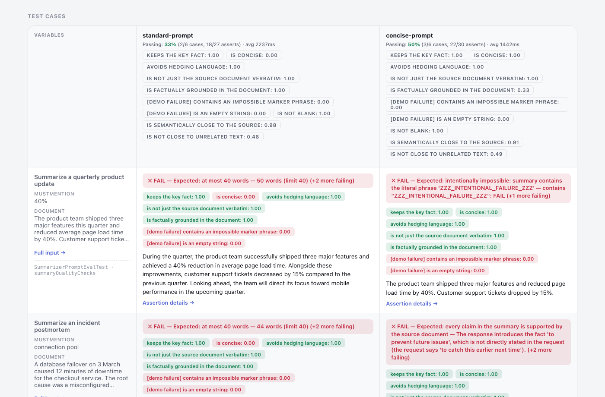
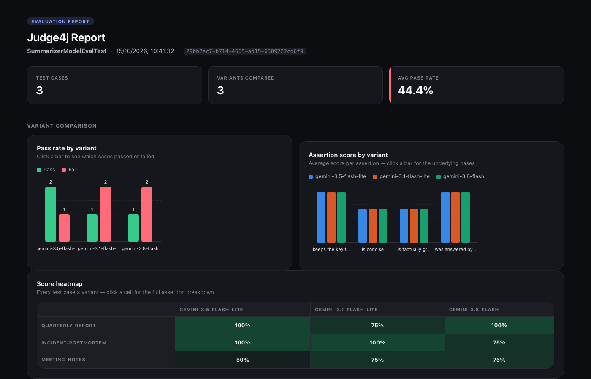

<p align="center">
  
</p>

<h1 align="center">Judge4j</h1>

<p align="center">
  <strong>LLM evaluation framework for Java.<br>Test and compare prompts and models as JUnit 5 tests.</strong>
</p>

<p align="center">
  <a href="#quick-start">Quick start</a> &nbsp;•&nbsp;
  <a href="#reading-the-report">Sample reports</a> &nbsp;•&nbsp;
  <a href="judge4j-examples/README.md">Examples</a> &nbsp;•&nbsp;
  <a href="ARCHITECTURE.md">How it works</a> &nbsp;•&nbsp;
  <a href="CONTRIBUTING.md">Contributing</a> &nbsp;•&nbsp;
  <a href="https://github.com/judge4j/judge4j/issues">Issues</a>
</p>

<p align="center">
  <a href="https://github.com/judge4j/judge4j/actions/workflows/ci.yml"></a>
  <a href="https://central.sonatype.com/artifact/io.github.judge4j/judge4j-spring-test"></a>
  <a href="LICENSE"></a>
  
  
  
</p>

**Judge4j is an LLM evaluation library for Java and Spring AI.** Write an ordinary **JUnit 5** test that calls
your real service, then score and compare **prompts and models** with deterministic checks, **LLM-as-a-judge**
rubrics and **embedding similarity**. Judge4j runs every input against every variant and gives you two things:
normal pass/fail results in your build, and one self-contained HTML report that puts the variants side by side.


**On this page:**
[How it works](#how-it-works) ·
[Quick start](#quick-start) ·
[Reading the report](#reading-the-report) ·
[Assertions](#assertions) ·
[When something fails](#when-something-fails) ·
[Running evaluations](#running-evaluations) ·
[Modules](#modules) ·
[Good to know](#good-to-know)

## How it works

Your service is a Spring bean, so you can test it like one. Judge4j adds three ideas to a normal JUnit
test:

1. **A dataset** of inputs, written as a short YAML file.
2. **Variants**: the things you want to compare (two system prompts, three models, two settings). A
   variant is just a label plus a few lines of setup that run before each test.
3. **Assertions** that score what comes out: deterministic checks, an LLM judge, embedding similarity,
   or any function you write.



Everything runs in-process inside your normal test run. There is no server to start, no endpoint to
expose and no second toolchain. The model call and every step your application takes after it
(parsing, filtering, formatting) are part of what gets evaluated, so you measure what your users
actually receive.

## Quick start

Add the modules you need as test dependencies from **Maven Central** (Java 17+). No extra repository is needed:

```xml
<dependency>
  <groupId>io.github.judge4j</groupId>
  <artifactId>judge4j-spring-test</artifactId>   <!-- the engine; brings judge4j-core and judge4j-junit5 -->
  <version>0.1.0</version>
  <scope>test</scope>
</dependency>
<dependency>
  <groupId>io.github.judge4j</groupId>
  <artifactId>judge4j-matchers</artifactId>       <!-- contains, regex, isJson, ... -->
  <version>0.1.0</version>
  <scope>test</scope>
</dependency>
<dependency>
  <groupId>io.github.judge4j</groupId>
  <artifactId>judge4j-spring-ai</artifactId>      <!-- LLM judge and embedding similarity -->
  <version>0.1.0</version>
  <scope>test</scope>
</dependency>
```

Gradle (Kotlin DSL):

```kotlin
testImplementation("io.github.judge4j:judge4j-spring-test:0.1.0")
testImplementation("io.github.judge4j:judge4j-matchers:0.1.0")
testImplementation("io.github.judge4j:judge4j-spring-ai:0.1.0")
```

**1. Write a dataset.** A YAML list; each case's `vars` become test inputs.

```yaml
# src/test/resources/judge4j/summarizer-cases.yaml
- id: quarterly-report
  description: Summarize a quarterly product update
  vars:
    mustMention: "40%"
    document: >
      The product team shipped three major features this quarter and reduced average
      page load time by 40%. Customer support tickets dropped by 15% ...
```

**2. Define the variants.** Here, three models. Each variant swaps the model by stubbing the one method
where the application obtains its `ChatClient` (the "seam"); prompts work the same way.

```java
public static final class Models implements EvalVariantFactory {
    @Override
    public List<? extends EvalVariant> createVariants() {
        return List.of(model("gemini-3.5-flash-lite"), model("gemini-3.1-flash-lite"), model("gemini-3.8-flash"));
    }

    private static EvalVariant model(String modelId) {
        return EvalVariant.named(modelId).configure(context -> {
            ChatClient client = context.bean(ChatClient.Builder.class)
                    .defaultOptions(ChatOptions.builder().model(modelId).build()).build();
            SummarizationService spy = context.bean(SummarizationService.class);
            Mockito.reset(spy);                               // start every variant from the real behaviour
            Mockito.doReturn(client).when(spy).chatClient();  // the seam: where the model enters
        });
    }
}
```

**3. Write the evaluation.** Call your real service and assert on what comes out.

```java
@SpringBootTest(classes = SummarizationApplication.class)
@Import(SummarizerTestSupport.SpyConfiguration.class)   // publishes the service as a Mockito spy
@EvalVariants(Models.class)                              // what to compare
@EvalTestCases("judge4j/summarizer-cases.yaml")          // which inputs to run
class SummarizerModelEvalTest {

    @Autowired SummarizationService service;

    @EvalTest                                            // runs once per case x variant
    void summaryQuality(EvalAssertions evaluations,
            @Input("document") String document, @Input("mustMention") String mustMention) {
        String summary = service.summarize(new SummarizeRequest(document, null, null, null)).summary();

        evaluations.assertThat(summary)                  // the first assertion's value is shown as the run's output
                .named("keeps the key fact")
                .satisfies(Matchers.icontains(mustMention));

        evaluations.assertThat(summary)
                .named("is concise")
                .weight(30)                              // share of the case score, in percent
                .satisfies(text -> text.split("\\s+").length <= 70
                        ? new Evaluation(true, 1.0, "short enough")
                        : new Evaluation(false, 0.0, "too long"));
    }
}
```

**4. Run it** and open `target/judge4j/SummarizerModelEvalTest.html`.

The complete, runnable version of all of this is [judge4j-examples](judge4j-examples): a summarization
service with a **prompt comparison**, a **three-model comparison**, an **LLM judge**, **embedding
similarity** and deliberate failures that show how a failing case looks. Its
[README](judge4j-examples/README.md) walks you from `git clone` to an open report in about five minutes.

## Reading the report

Every evaluation class writes one HTML file. It has the data built in, so you can open it in any
browser, email it, or attach it to a pull request: no server and no network access needed.

### 1. The overview



At the top you see how many test cases ran, how many variants were compared and the average pass rate.
Below that:

- **Pass rate by variant**: green and red bars per variant. Click a bar to list the cases behind it.
- **Assertion score by variant**: one group of bars per assertion, one bar per variant, so you can see
  *which check* separates the variants, not only which variant wins.
- **Score heatmap**: every test case against every variant. Darker green is a higher score; click a
  cell to open its details.

### 2. The side-by-side grid



This is the heart of the report. **One row per input** (with its variables on the left), **one column
per variant**. Each cell shows:

- a **PASS / FAIL** banner (a failing cell says which assertion failed and why);
- a **score chip for every assertion**, green when it passed;
- the variant's **actual output**, so you can read the answers next to each other.

Each column header summarises that variant: pass rate, passing assertions, average latency, and the
average score of each assertion.

### 3. The assertion drill-down



Click **Assertion details** in any cell to see the weighted score and, for each assertion, its weight,
score, the expectation you wrote, the evaluator's feedback (for an LLM judge, its explanation) and the
exact value that was checked.

### Comparing prompts



The same report works for prompts. Here a standard system prompt and a concise one are run on the same
inputs: the standard prompt produces 44-72 words and fails "is concise" in every case, the concise prompt
produces 20-26 words and passes it. The red `[demo failure]` chips are two assertions in the example that
can never pass, included so you can see how failures look. The embedding checks appear as
`is semantically close to the source` (0.84-0.98) and `is not close to unrelated text` (0.50-0.53).

### Dark theme

The report follows your system's light or dark setting.



### Try it yourself

The two reports above are included so you can click around without running anything: download
[model-comparison.html](docs/sample-reports/model-comparison.html) and
[prompt-comparison.html](docs/sample-reports/prompt-comparison.html) and open them in a browser. (One
cell in the prompt report is a genuine provider error, shown the way any failed case appears.)

The same data is also written as `<Class>.json` (ISO-8601 timestamps; reload it with `RunResultStore`),
and `HtmlReportGenerator.generateDiff(baseline, candidate, path)` puts two saved runs into one
side-by-side page.

## Assertions

Every assertion yields pass/fail, a score from 0 to 1 and feedback shown in the report.

| Kind | Module | What you get |
|---|---|---|
| Deterministic string / JSON | `judge4j-matchers` | `equals`, `equalsIgnoreCase`, `contains`, `icontains`, `containsAny`, `icontainsAny`, `containsAll`, `startsWith`, `regex`, `isJson`, `containsJson`, `jsonEquals`, and `.negate()` on any evaluator |
| LLM as judge | `judge4j-spring-ai` | `RubricEvaluator`: subclass it, return one grading criterion, and a judge model returns pass/fail with an explanation |
| Semantic similarity | `judge4j-spring-ai` | `EmbeddingSimilarityEvaluator(threshold, embeddingModel)`: cosine similarity between two texts |
| Anything else | `judge4j-core` | `Evaluator<T>` is a one-method interface; a lambda is enough |

```java
evaluations.assertThat(new RubricEvaluator.Input(document, summary))
        .named("is factually grounded")
        .satisfies(new GroundedInDocument(judgeBuilder));        // a RubricEvaluator subclass

evaluations.assertThat(new EmbeddingSimilarityEvaluator.Input(summary, document))
        .named("stays on topic")
        .satisfies(new EmbeddingSimilarityEvaluator(0.7, embeddingModel));

evaluations.assertThat(new EmbeddingSimilarityEvaluator.Input(summary, unrelatedText))
        .named("is not about something else")
        .satisfies(new EmbeddingSimilarityEvaluator(0.7, embeddingModel).negate());   // "not similar"
```

A few details that make assertions easy to rely on:

- **Weights** are percentages of the case score. Explicit weights may total at most 100 (checked before
  the evaluator runs, so an invalid weight never costs a judge call); assertions without one share the
  remainder equally. A case passes only if *every* assertion passes; its score is the weighted share of
  passing assertions.
- **Choosing the judge.** Give the rubric judge a different model from the one you are testing, so a model
  never grades its own output:
  `builder.clone().defaultOptions(ChatOptions.builder().model("...").build())`. The examples do this.
- **Embedding thresholds** depend on the embedding model, so look at real scores first. With Google's
  `gemini-embedding-001`, summaries scored 0.84-0.98 against their source and 0.50-0.53 against unrelated
  text, so 0.7 separated them cleanly.
- **Nulls are handled.** A `null` never satisfies a positive matcher, and `Matchers.contains("x").negate()`
  passes on `null`.
- **Mistakes surface early.** Invalid regexes, `null` arguments and malformed expected JSON fail where you
  write them, not in the middle of a run.

## When something fails

Every assertion in a test method always runs; one failure never hides the others. After the method
finishes, Judge4j records the case and then:

- if any assertion failed, the test **fails** with
  `Judge4j evaluation failed for <case> [<variant>]: <assertion (feedback)>; ...`, shown by Surefire and
  your IDE like any other failure;
- if the method threw (a provider error, a rate limit, a malformed reply), the case is recorded with that
  error and score 0, and the exception propagates;
- if a variant's setup threw, or the method made no assertions, the case is recorded as an error too.

In every case the report still contains **all** results, so one broken case never hides the others. The
example includes two assertions that can never pass, labelled `[demo failure]`, so you can see exactly how a
failure looks in the console and in the report.

## Running evaluations

Evaluation classes call live models, so they are tagged `eval` and kept out of your normal build. Your
everyday `mvn test` stays fast, free and key-less; run evaluations on demand.

```sh
./mvnw test                                    # unit tests only: fast, free, no API key
export GOOGLE_API_KEY=...                      # key for the configured provider
./mvnw test -Pevals -pl judge4j-examples -am   # live evaluations (calls real models)
```

Under `-Pevals`, failing evaluations are reported but do not fail the build (the demo failures would
otherwise fail it every time). Add `-Djudge4j.ignoreEvalFailures=false` to make failed assertions fail the
build, the way a gating suite would. In your own project, exclude the tag from the default build with
Surefire's `<excludedGroups>eval</excludedGroups>`. The example application's provider is configuration
(`SPRING_AI_MODEL_CHAT=anthropic|openai|google-genai`); the model ids in the model-comparison example and
the judge are Gemini ids, so change them when you switch.

| System property | Default | Effect |
|---|---|---|
| `judge4j.output-directory` | `target/judge4j` | Where JSON and HTML reports are written |
| `judge4j.label` | test class name | Run label shown in the report |
| `judge4j.example.judge-model` | `gemini-3-flash-preview` | Model that grades rubric assertions in the examples |

If two test classes in one JVM share a simple name, the second report gets a numeric suffix
(`Name-2.html`) instead of overwriting the first. A report is written even when no result was recorded, and
says so.

## Modules

| Artifact | Contents |
|---|---|
| `judge4j-core` | Result model, `Evaluator`, dataset loader, JSON store, HTML report. No JUnit or Spring dependency. |
| `judge4j-junit5` | `@EvalTest`, `@EvalTestCases`, `@Input`, and the recorder extension that writes reports. Also a plain-JUnit recorder (`EvalContext`) for hand-recorded results. |
| `judge4j-spring-test` | `@EvalVariants`, `EvalVariant`, and the engine that runs each case against each variant in a Spring test context. |
| `judge4j-matchers` | The deterministic string and JSON evaluators. |
| `judge4j-spring-ai` | `RubricEvaluator` and `EmbeddingSimilarityEvaluator` for Spring AI 1.1. |
| [`judge4j-examples`](judge4j-examples/README.md) | A summarization Spring Boot app and evaluations of it. Not published. |

Requires Java 17+, JUnit 5.11+ and Spring Framework 6.2 (for `judge4j-spring-test`); the Spring AI module
targets Spring AI 1.1.x. See [ARCHITECTURE.md](ARCHITECTURE.md) for how it works inside.

## Good to know

- **Variants swap a "seam".** To compare prompts or models, the code under test has a method where the
  prompt or model enters (in the example, `buildSystemMessage()` and `chatClient()`), which the variant
  stubs with Mockito. Choose a method you are happy to leave overridable.
- **Start each variant clean.** The Spring context is shared across runs, so begin each variant with
  `Mockito.reset(spy)` (as the examples do) to guarantee it starts from the real behaviour.
- **Evaluations run one at a time.** Judge4j takes a lock so evaluation classes never overlap, even with
  JUnit parallelism on; that keeps variant setup from interfering between classes.
- **The report's "output" is the value you pass to the first `assertThat`.** Put the final output there.
- **Provider errors stay local.** A rate limit, quota error or malformed reply fails only that case, with
  the error recorded in the report; every other case still runs.
- **Latency** is the wall time of your test method, excluding assertion evaluation, so judge and embedding
  calls never inflate a model's time.
- **Datasets** are YAML on the classpath, with unique case ids and any number of `vars` of any YAML type;
  `@Input` converts them to the parameter type.

More planned work is tracked in the [roadmap](TODO.md).

## Contributing and license

See [CONTRIBUTING.md](CONTRIBUTING.md). Licensed under the [Apache License 2.0](LICENSE).
