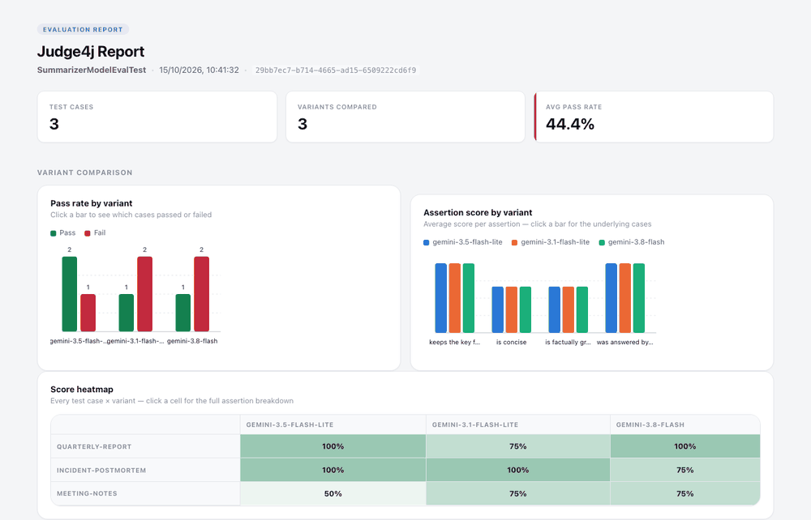

# Judge4j example: a summarizer you can evaluate

This is the sample project for [Judge4j](../README.md). It contains a small **document-summarization
service** (a Spring Boot app that calls an LLM) and **evaluations of it** that compare two prompts and
three models, then produce an HTML report you can open in your browser.

Use it to see Judge4j working end to end in about five minutes, and as a template for evaluating your own
service.



## What you need

- **Java 17 or newer** (`java -version`). Maven is included; use `./mvnw`, no install needed.
- **A Google Gemini API key** for the live evaluations. A free key from
  [Google AI Studio](https://aistudio.google.com/apikey) is enough, but free keys have per-model daily
  limits (see [Troubleshooting](#troubleshooting)).

The service can also use Anthropic or OpenAI (see [Using another provider](#using-another-provider)).

## Quick start

Run everything from the **repository root** (the folder containing `pom.xml`), not from this folder.

```sh
# 1. Build and run the offline tests. No key needed, no API calls, takes under a minute.
./mvnw test

# 2. Give the project your key. This lasts for the current terminal session.
export GOOGLE_API_KEY='paste-your-key-here'

# 3. Run the live evaluations. They call the real model, so they use your quota.
./mvnw test -Pevals -pl judge4j-examples -am

# 4. Open the reports.
open judge4j-examples/target/judge4j/SummarizerModelEvalTest.html
open judge4j-examples/target/judge4j/SummarizerPromptEvalTest.html
```

(On Linux use `xdg-open`; on Windows use `start` and `set GOOGLE_API_KEY=...`.)

Step 3 sends roughly 50 requests and takes a few minutes. When it finishes you will see two lines like
`Judge4j report: file:///.../SummarizerModelEvalTest.html`. Those are your reports.

> **Reading the result.** Under `-Pevals` the Maven build always ends in `BUILD SUCCESS`, even when
> assertions fail, because this project contains deliberate failures (see
> [What to expect](#what-to-expect)). So judge a run by the `Tests run: ...` lines and by the report, not by
> the final BUILD line. If you see `Errors: 9` / `Errors: 12` and `UnsatisfiedDependencyException`, the
> key is missing.

### To keep the key between sessions

Add the `export` line to `~/.zshrc` (or `~/.bashrc`), or set `GOOGLE_API_KEY` as an environment variable in
your IDE's run configuration. Never put the key in a file that is committed.

## What to expect

The evaluations run the **real** summarization service against a **real** model, for every case in
[`summarizer-cases.yaml`](src/test/resources/judge4j/summarizer-cases.yaml) (three documents).

| Report | Compares | Runs | What it shows |
|---|---|---|---|
| `SummarizerPromptEvalTest` | a standard system prompt vs a concise one | 12 | The standard prompt produces 44-72 words and fails the conciseness check every time; the concise prompt produces 20-26 words and passes it. Also demonstrates keyword checks, an LLM judge, embedding similarity, and two assertions that are **meant to fail** (named `[demo failure]`) so you can see how failures look. |
| `SummarizerModelEvalTest` | three Gemini models on the same prompt | 9 | Each model's answer side by side, how each scored on four checks, and how long each took (typically 3 s, 6 s and 14 s). One check confirms every response really came from the model the variant asked for. |

So **some red in the report is correct**: the `[demo failure]` chips always fail, and the LLM judge
sometimes flags a summary that adds a detail the source did not contain. That is Judge4j doing its job.

See [Reading the report](../README.md#reading-the-report) in the main README for a tour of what each part
of the page means, or open the saved examples without running anything:
[model comparison](../docs/sample-reports/model-comparison.html) and
[prompt comparison](../docs/sample-reports/prompt-comparison.html).

## More ways to run it

**Run one evaluation class only:**

```sh
./mvnw test -Pevals -pl judge4j-examples -am -Dtest=SummarizerModelEvalTest -Dsurefire.failIfNoSpecifiedTests=false
```

**Make failed assertions fail the build** (the way a real gating suite would). The demo failures will then
fail it:

```sh
./mvnw test -Pevals -pl judge4j-examples -am -Djudge4j.ignoreEvalFailures=false
```

**Choose which model grades the rubric assertions** (default `gemini-3-flash-preview`). Use a model different
from the ones you are testing, so a model does not grade its own output:

```sh
./mvnw test -Pevals -pl judge4j-examples -am -Djudge4j.example.judge-model=gemini-3.5-flash-lite
```

**Write reports somewhere else, or name the run:**

```sh
./mvnw test -Pevals -pl judge4j-examples -am -Djudge4j.output-directory=/tmp/reports -Djudge4j.label=my-first-run
```

**Run the summarizer service itself** (the application the evaluations test), as a normal web app on port 8081:

```sh
./mvnw -pl judge4j-examples -am package -DskipTests
export GOOGLE_API_KEY='paste-your-key-here'
java -jar judge4j-examples/target/judge4j-examples-0.1.0-SNAPSHOT.jar
```

Then, in another terminal:

```sh
curl -s http://localhost:8081/actuator/health
curl -s http://localhost:8081/api/v1/summaries/styles
curl -s -X POST http://localhost:8081/api/v1/summaries \
  -H 'Content-Type: application/json' \
  -d '{"document":"The product team shipped three major features this quarter and reduced average page load time by 40%. Customer support tickets dropped by 15% compared to last quarter. The team plans to focus on mobile performance next quarter.","style":"TLDR"}'
```

The document must be at least 200 characters. Styles are `PARAGRAPH`, `BULLETS`, `EXECUTIVE` and `TLDR`.
Without `GOOGLE_API_KEY` the app refuses to start, on purpose.

## How it is put together

```
judge4j-examples/
├── src/main/java/.../summarization/
│   ├── SummarizationApplication.java    the Spring Boot app
│   ├── api/                             REST controller and request/response types
│   ├── service/SummarizationService.java  validation, prompt building, model call, result parsing
│   └── config/                          ChatClient setup and business-rule settings
├── src/main/resources/
│   ├── application.yml                  provider, model, and embedding settings
│   └── prompts/                         the system prompts being compared (+ the user prompt)
└── src/test/
    ├── java/.../SummarizationServiceTest.java     offline tests of the service (no model; run by ./mvnw test)
    ├── java/.../SummarizerPromptEvalTest.java     the prompt comparison
    ├── java/.../SummarizerModelEvalTest.java      the three-model comparison
    ├── java/.../SummarizerTestSupport.java        shared setup: the Mockito spy, the judge model, a custom evaluator
    ├── java/.../SummaryGroundedInDocumentEvaluator.java   an LLM-judge criterion in ~10 lines
    ├── java/.../RecordingChatModel.java           a stand-in model used by the offline tests
    └── resources/judge4j/summarizer-cases.yaml    the test inputs
```

The idea in one paragraph: the service wraps its model call and its system prompt in two small methods
(`chatClient()` and `buildSystemMessage()`). The evaluations wrap the service in a Mockito spy and, for each
variant, replace one of those methods, so the **same real code** runs with prompt A or prompt B, or with model
X or model Y. Nothing else is faked. Open `SummarizerModelEvalTest.java`; it is about 100 lines and
heavily commented.

## Make it your own

Good first experiments (re-run step 3 after each):

- **Add a test case.** Append an entry to `summarizer-cases.yaml` (`id`, `description`, `vars` with a
  `document` of 200+ characters and a `mustMention` phrase). A new row appears in both reports.
- **Compare a different prompt.** Copy `prompts/summarize-system-concise.st`, edit it, and add it as a third
  variant in `SummarizerPromptEvalTest.SystemPrompts`.
- **Compare other models.** Change the ids in `SummarizerModelEvalTest.Models`. Pick models your key can
  use (see Troubleshooting for how to list them).
- **Add a check.** Add another `evaluations.assertThat(summary)...` call. `Matchers.contains(...)`, a regex, or
  a lambda are all one-liners.
- **Break something on purpose.** Lower `MAX_WORDS` in the model test and watch which models start failing.

## Using another provider

The application's provider is configuration. Set it with an environment variable and provide that provider's key:

```sh
export SPRING_AI_MODEL_CHAT=anthropic   # or: openai | google-genai (default)
export ANTHROPIC_API_KEY='...'          # OPENAI_API_KEY for openai
```

Two things are Gemini-specific and need editing when you switch: the **model ids** in
`SummarizerModelEvalTest.Models` (and the judge, via `-Djudge4j.example.judge-model=...`), and the **embedding
model**, which always uses Google, so the embedding check in the prompt evaluation still needs
`GOOGLE_API_KEY` even when chat uses another provider.

## Troubleshooting

| What you see | Why | What to do |
|---|---|---|
| `Errors: N` and `UnsatisfiedDependencyException` in the test output, or the app exits at startup | `GOOGLE_API_KEY` is not set in this terminal | `export GOOGLE_API_KEY=...` and run again |
| `429 ... exceeded your current quota` | Free keys have per-model daily and per-minute limits; the model (often the judge) is used up | Wait, or choose another model, e.g. `-Djudge4j.example.judge-model=gemini-3.5-flash-lite`. Affected cases show the error in the report; other cases still run |
| `503 ... experiencing high demand` | Temporary overload on the provider's side | Run again in a minute |
| `404 ... no longer available to new users` | That model id is retired for your key | Pick a model your key can use. List them: `curl -s -H "x-goog-api-key: $GOOGLE_API_KEY" https://generativelanguage.googleapis.com/v1beta/models` |
| One case shows an error about parsing JSON | The model returned a malformed reply once | Normal for LLMs; the case is recorded as an error and the rest are unaffected. Re-run to retry |
| No `.html` files | You ran `./mvnw test` without `-Pevals`; evaluations are excluded from the default build | Add `-Pevals -pl judge4j-examples -am` |
| `permission denied: ./mvnw` | The wrapper script is not executable | `chmod +x mvnw` |

Back to the [main README](../README.md).
